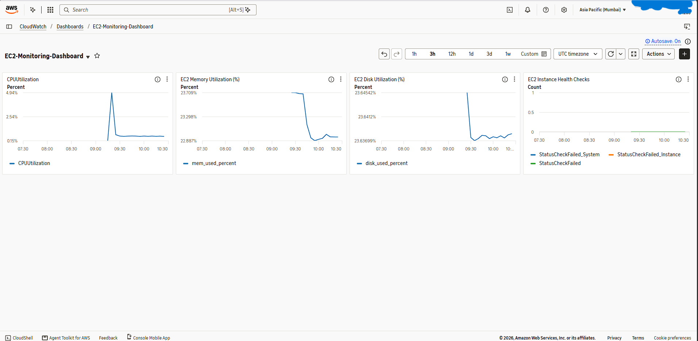
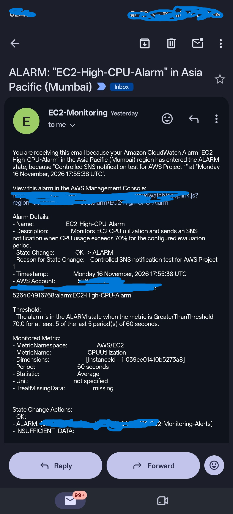

# AWS CloudWatch Infrastructure Monitoring

## Project Overview

This project demonstrates infrastructure monitoring for an Amazon EC2 Linux instance using Amazon CloudWatch and the CloudWatch Agent.

## AWS Services Used

- Amazon EC2
- Amazon CloudWatch
- AWS IAM
- Amazon VPC

## Monitoring Configuration

- **EC2 Instance:** ec2-monitoring-linux-01
- **Operating System:** Amazon Linux 2023
- **AWS Region:** ap-south-1 (Mumbai)
- **IAM Role:** role-ec2-monitoring-project
- **CloudWatch Namespace:** CWAgent
- **Dashboard:** EC2-Monitoring-Dashboard

## Verified Monitoring Metrics

| Metric | Purpose |
|---|---|
| CPUUtilization | Monitor CPU utilization |
| mem_used_percent | Monitor memory utilization |
| disk_used_percent | Monitor root filesystem utilization |
| StatusCheckFailed | Detect EC2 status-check failures |
| StatusCheckFailed_Instance | Detect instance-level failures |
| StatusCheckFailed_System | Detect underlying infrastructure failures |

## Implementation

1. Configured IAM permissions for the EC2 monitoring role.
2. Installed Amazon CloudWatch Agent on Amazon Linux 2023.
3. Configured memory and disk utilization collection.
4. Verified metrics in CloudWatch.
5. Created a four-widget infrastructure monitoring dashboard.

## Verification

CloudWatch graphs displayed CPU, memory, disk, and instance health monitoring data.

## Dashboard Evidence

The CloudWatch dashboard displays real-time infrastructure monitoring for an Amazon Linux 2023 EC2 instance.

The dashboard includes CPU utilization, memory utilization, disk utilization, and EC2 instance status checks.

## Future Improvements

## Monitoring and Alerting Evidence

### CloudWatch Dashboard

### CloudWatch Alarms

### SNS Alarm Notification

### Architecture Diagram
[View AWS Monitoring Architecture](architecture/aws-monitoring-architecture.md)

## Testing and Validation

All infrastructure monitoring and notification integration checks were completed successfully.

[View Testing and Validation Report](docs/testing-and-validation.md)

## Cost Management

[View AWS Cost Cleanup Checklist](docs/cost-cleanup.md)
