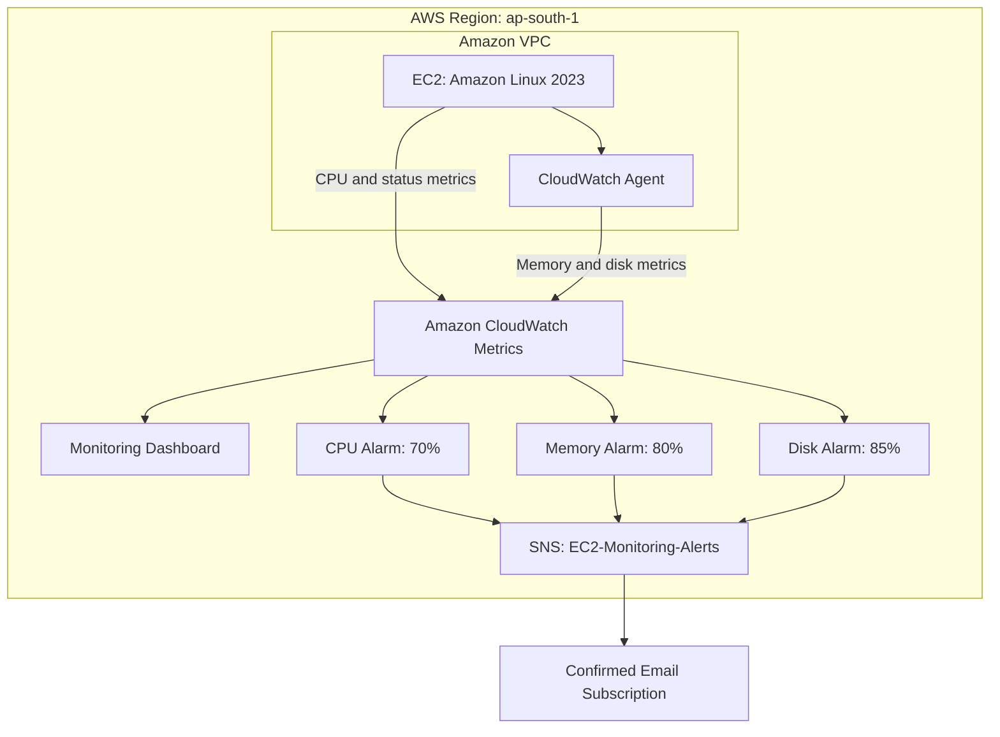

# AWS EC2 Monitoring Architecture

## Monitoring and Alerting

- CPU alarm: greater than 70%
- Memory alarm: greater than 80%
- Disk alarm: greater than 85%
- Evaluation: 5 consecutive one-minute datapoints
- Notification delivery: Amazon SNS email subscription
